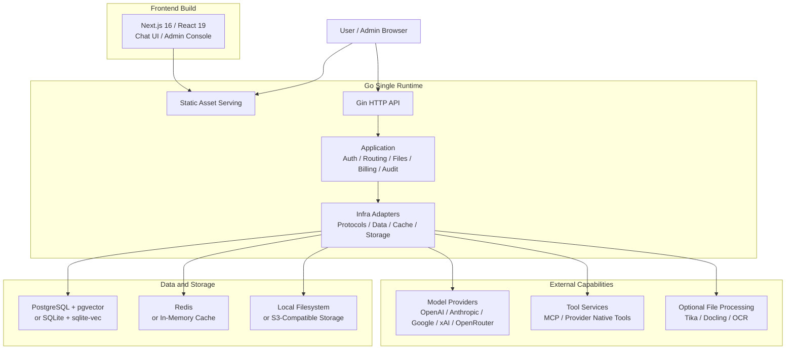

<p align="center">
  <picture>
    <source media="(prefers-color-scheme: dark)" srcset="../apps/web/public/logo-white.svg" />
    
  </picture>
</p>

<p align="center">
  엔터프라이즈 모델 라우팅, 대화, 파일, 도구, 결제, 신원, 운영을 하나로 통합한 AI 플랫폼입니다.
</p>

<p align="center">
  <a href="../README.md">English</a> | <a href="./README.zh-CN.md">简体中文</a> | 한국어
</p>

<p align="center">
  <a href="https://deeix.com"></a>
  <a href="https://deeix.com/docs/deeix-chat/quickstart"></a>
  <a href="https://t.me/deeix_chat"></a>
  <a href="https://x.com/DEEIX_AI"></a>
  <a href="https://www.apache.org/licenses/LICENSE-2.0"></a>
  
  
  
</p>

## 개요

DEEIX Chat 은 여러 모델 공급자에 장기간 안정적으로, 그리고 하나의 창구로 접근해야 하는 개인, 팀, 기업을 위한 오픈소스 배포형 AI 플랫폼입니다. 여러 업스트림 모델과 공급자로 들어가는 명확한 진입점 하나를 제공하며, 멀티모달 대화, 모델 라우팅, 파일과 RAG, MCP 도구, 사용량 결제, 신원, 감사 로그, 운영 통제를 한 제품으로 통합합니다.

이 시스템은 단순한 배포, 효율적인 정적 전달, 낮은 런타임 자원 사용을 중심으로 설계되었습니다. 가볍지만 기능이 제한되지 않고, 절제돼 있지만 역량을 잃지 않으며, 열려 있지만 무질서해지지 않도록 만들었습니다.


## 기능

| 영역 | 역량 |
| --- | --- |
| 대화 | 일상적으로 쓰는 멀티모달 채팅 인터페이스로, 스트리밍, 분기, 재시도, 편집, 피드백, 공유, 리치 렌더링, 추적 가능한 모델 실행 메타데이터를 지원합니다. |
| 모델과 라우팅 | 업스트림 채널, 실제 모델, 라우트 바인딩, 우선순위, 가중치, 서킷 브레이킹, 벤더 매핑, 역량 설정을 다루는 플랫폼 모델 계층으로, 여러 공급자를 함께 운영하는 비용을 낮춥니다. |
| 프로토콜과 어댑테이션 | OpenAI, Anthropic, Google/Gemini, xAI, OpenRouter, OpenAI 호환 프로토콜을 텍스트, 이미지, 도구, 공급자 고유 역량 차이에 걸쳐 통합 지원합니다. |
| 파일과 검색 | 파일 업로드, 미리보기, 추출, OCR, 저장 할당량, 전체 컨텍스트 주입, 청크 분할, 임베딩, 시맨틱 검색을 제공해 파일 내용이 자연스럽게 대화 컨텍스트로 들어오게 합니다. |
| 도구 생태계 | MCP 서버와 공급자 고유 공식 도구를 대상으로 탐색, 활성화, 사용자 선택, 실행 제한, 결과 렌더링, 도구 호출 추적을 제공합니다. |
| 컨텍스트와 메모리 | 메시지 윈도, 토큰 예산, 요약 압축, 대화 메모리, 장기 메모리, RAG 근거 기록을 통해 비용을 통제하면서 맥락을 이어 갑니다. |
| 결제와 페이먼트 | 모델 가격, 호출당 도구 가격, 구독, 충전, 잔액, 사용 원장, 결제 스냅샷, Stripe Checkout, EPay, 웹훅 검증을 제공합니다. |
| 신원과 보안 | 로컬 계정, 세션 관리, HttpOnly 리프레시 쿠키, 2FA/TOTP, 신뢰 기기, SSO/OIDC/OAuth, 연락처 인증, 민감 데이터 암호화를 제공합니다. |
| 관리와 감사 | 사용자, 역할, 업스트림, 모델, 라우트, 가격, 구독, 잔액, 사용 로그, 감사 로그, 인증 이벤트, 시스템 이벤트를 한곳에서 관리합니다. |
| 배포와 운영 | 단일 런타임 프론트엔드/API 서빙, Docker 배포, SQLite 또는 PostgreSQL, 인메모리 캐시 또는 Redis, S3 호환 스토리지, Swagger, 구조화 로그, 버전 엔드포인트, GeoIP, OpenTelemetry 를 제공합니다. |

<p align="center">
  
  
</p>

<p align="center">
  
  
  
</p>

## 아키텍처와 기술 스택

DEEIX Chat 은 프론트엔드와 백엔드를 나누어 개발하되 배포는 단일 런타임 경로로 합니다. 프론트엔드는 정적 자산으로 빌드되어 Go 서비스가 서빙하고, API, 인가, 모델 라우팅, 파일, 결제, 감사 역량은 같은 백엔드 런타임에서 돌아갑니다. 무거운 문서 추출과 OCR 역량은 선택 서비스로 두어, 기본 배포는 가볍게 유지합니다.



| 계층 | 책임 | 기술 |
| --- | --- | --- |
| 프론트엔드 | 채팅 UI, 관리 콘솔, 정적 빌드 | Next.js 16, React 19, TypeScript, Tailwind CSS, Shadcn/UI, Streamdown, KaTeX, Mermaid, Recharts, Motion |
| 백엔드 런타임 | API, 인증, 인가, 오케스트레이션, 프로토콜 어댑테이션, 정적 서빙 | Go 1.26, Gin, Gorm, Swagger, OpenTelemetry, Zap |
| 데이터와 캐시 | 도메인 데이터, 벡터 검색, 세션 상태, 런타임 캐시 | PostgreSQL, pgvector, SQLite, sqlite-vec, Redis, 인메모리 캐시 |
| 파일과 스토리지 | 업로드 파일, 생성 파일, 오브젝트 스토리지, 로컬 영속화 | 로컬 파일시스템, S3 호환 오브젝트 스토리지 |
| 파일 처리 | 텍스트 추출, OCR, 문서 파싱, LLM OCR 폴백 | 내장 추출기, Apache Tika, Docling, RapidOCR, Tesseract OCR, Paddle OCR, 클라우드 OCR 어댑터, MinerU |
| 도구 프로토콜 | MCP 도구 연동과 공급자 고유 공식 도구 | MCP Streamable HTTP JSON-RPC, 공급자 고유 도구 |
| 배포 런타임 | 경량 단일 노드 배포 또는 다중 노드 프로덕션 배포 | Docker, Docker Compose, SQLite/인메모리 캐시, PostgreSQL/Redis |

백엔드는 내부 경계를 뚜렷하게 유지합니다. `backend/cmd/server` 는 실행 파일 진입점, `backend/internal/cli` 는 프로세스 기동, `backend/internal/app` 은 애플리케이션 조립과 배선, `backend/internal/transport/http` 는 HTTP 경계를 담당합니다. 요청은 `application` 유스케이스를 거쳐 소비자가 소유한 `repository` 또는 `ports` 인터페이스와 그 `infra` 구현으로 흐릅니다. 데이터 계층은 도메인 접두사를 붙인 테이블을 쓰고, 재무 기록, 감사 추적, 시스템 이벤트, 빠르게 늘어나는 벡터 데이터는 각각 별도의 진실 원천으로 둡니다.

## 저장소 구조

```text
.
├── backend/                  # Go API and single-runtime server
│   ├── cmd/server/            # executable entrypoint
│   ├── internal/
│   │   ├── cli/               # process startup
│   │   ├── app/               # dependency wiring and lifecycle
│   │   ├── application/       # use cases and orchestration
│   │   ├── domain/            # business concepts and rules
│   │   ├── ports/              # outbound integration contracts
│   │   ├── repository/         # persistence contracts
│   │   ├── infra/              # persistence, cache, storage, providers
│   │   ├── transport/http/     # handlers, DTOs, middleware, routes
│   │   └── shared/             # cross-cutting response and security code
│   └── docs/                  # generated Swagger artifacts
├── apps/                     # client applications (one directory per platform)
│   ├── web/                  # Next.js App Router and static export
│   └── desktop/              # Tauri 2 shell: tray, deep links, auto-update, OS keychain
│       ├── app/              # route entries and layouts
│       ├── features/         # feature-owned UI and client workflows
│       ├── entities/         # reusable business entities
│       ├── shared/           # API, auth, UI, hooks, models, utilities
│       ├── components/       # UI primitives and visual components
│       └── public/           # static assets
├── packages/
│   ├── api-contract/         # generated TypeScript API contract (single source for all clients)
│   └── core/                 # platform-agnostic client logic shared by web / desktop / mobile
├── deploy/                    # Docker deployment: compose profiles, config templates, optional services
├── docs/                      # project guides and screenshots
└── Dockerfile                 # frontend + backend production image
```

`apps/web/` 와 `backend/` 는 pnpm 과 Turborepo 로 관리되는 독립 워크스페이스입니다. `packages/api-contract/` 가 생성된 Swagger 타입으로 둘을 잇습니다. HTTP 계약을 바꿀 때는 Go 트랜스포트 계약을 먼저 고친 뒤 공유 패키지를 다시 생성하세요. `packages/core/` 는 모든 플랫폼에서 동일하게 유지해야 하는 클라이언트 로직을 담으며, 어떤 UI 나 플랫폼 프레임워크도 import 할 수 없습니다. 플랫폼 경계와 규칙은 [docs/ARCHITECTURE.md](ARCHITECTURE.md) 를 참고하세요.

## 사전 요구 사항

- Node.js 20.9 이상 (저장소 Docker 이미지와 CI 는 Node.js 24 를 사용합니다).
- pnpm 10.17.0, 보통 Corepack 으로 활성화합니다.
- 백엔드 개발용 Go 1.26.8.
- 컨테이너 배포나 로컬 PostgreSQL/Redis 서비스를 위한 Docker Compose v2 를 갖춘 Docker Engine.

SQLite 프로파일은 별도로 관리하는 데이터베이스나 캐시가 필요 없습니다. 기본 개발 설정은 PostgreSQL 과 Redis 를 사용하며, 전체(full) Compose 프로파일이 두 서비스를 함께 띄워 줍니다.

## 빠른 시작

> 빠른 설치 안내: [Quick Start](https://deeix.com/docs/deeix-chat/quickstart).

### 로컬 개발

로컬 개발은 소스 코드를 편집하면서 프론트엔드와 백엔드를 따로 실행하는 용도입니다. 기본 설정은 로컬 PostgreSQL 과 Redis 에 연결합니다. 의존성을 최소로 해서 가볍게 체험만 하려면 아래의 경량 Docker 설치를 쓰세요.

1. 백엔드 설정 준비:

```bash
cp deploy/config.example.yaml config.yaml
```

로컬 환경에 맞게 `config.yaml` 의 `database.postgres.dsn`, `database.redis.*`, 공개 URL 을 조정하세요.

2. 워크스페이스 의존성 설치와 프론트엔드 환경 준비:

```bash
pnpm install
cp apps/web/.env.example apps/web/.env.local
```

3. 프론트엔드와 백엔드를 함께 시작:

```bash
make dev
```

`make api`, `make web`, `make desktop` 은 앱을 하나씩 실행하고, `make help` 는 전체 목록을 보여 줍니다.

프론트엔드는 API 요청에 `NEXT_PUBLIC_API_BASE_URL` 을 사용합니다. 로컬 개발에서는 `apps/web/.env.local` 에 다음이 들어 있는지 확인하세요:

```env
NEXT_PUBLIC_API_BASE_URL=http://127.0.0.1:8080
```

서비스 URL 과 프로브:

| 서비스 | URL |
| --- | --- |
| 프론트엔드 | `http://localhost:3000` |
| API | `http://localhost:8080` |
| Liveness | `http://localhost:8080/healthz` |
| Readiness | `http://localhost:8080/readyz` |
| Version | `http://localhost:8080/api/v1/version` |
| Swagger (개발 전용) | `http://localhost:8080/swagger/index.html` |

`NEXT_PUBLIC_API_BASE_URL` 을 지정하지 않으면 로컬 개발은 `localhost:8080` 을 기본값으로 쓰고, 동일 출처(same-origin) 배포는 현재 출처를 사용합니다.

### 워크스페이스 명령

루트 `Makefile` 이 단일 진입점입니다. 모든 타깃은 저장소 루트에서 실행되며 내부적으로 pnpm / turbo / cargo / go 로 연결됩니다.

| 명령 | 용도 |
| --- | --- |
| `make dev` | 프론트엔드와 백엔드를 watch 모드로 실행. |
| `make api` / `make web` / `make desktop` | 앱을 하나씩 실행. |
| `make check` | 모든 워크스페이스의 린트, 타입, 아키텍처, 버전 검사. |
| `make test` | 모든 워크스페이스의 테스트. |
| `make build` | 정적 프론트엔드, 백엔드 바이너리, 데스크톱 빌드(turbo, 캐시 사용). |
| `make build-desktop` / `make release-desktop` | 빠른 로컬 `.app` / 서명된 릴리스 번들. |
| `make verify` | check + test + build, CI 가 실행하는 것. |
| `make api-docs` | Swagger 산출물과 TypeScript API 타입 재생성. |
| `make version` | `VERSION` 을 모든 패키지 매니페스트에 전파. |

같은 동사가 pnpm 스크립트(`pnpm dev:api`, `pnpm check`, …)로도 있어 그쪽을 선호하는 도구에서 쓸 수 있고, CI 는 이를 직접 사용합니다.

프론트엔드는 정적 파일로 내보내지므로 `pnpm build` 는 브라우저 산출물을 `apps/web/out` 에 씁니다. Go 서비스는 프로덕션 이미지에서 또는 `server.frontend_dist_dir` 를 통해 그 디렉터리를 서빙할 수 있습니다.

### Docker 배포

모든 Docker 자산은 [`deploy/`](../deploy/README.md) 에 있습니다. 이 디렉터리만 서버로 복사하면 되고 애플리케이션 소스는 필요 없습니다. 아래 명령은 모두 `deploy/` 안에서 실행합니다. 먼저 설치 프로파일을 하나 고른 뒤, 해당 설정 템플릿을 `deploy/config.yaml` 로 복사하세요. 모든 프로파일은 기본적으로 앱을 `http://localhost:8080` 에 노출하고, (`deploy/` 기준) `./config.yaml` 을 컨테이너 안 `/app/config.yaml` 로 마운트합니다.

| 프로파일 | 사용 사례 | 설정 파일 | Compose 파일 | 내장 의존성 |
| --- | --- | --- | --- | --- |
| 경량(Lightweight) | 로컬 평가, 개인 사용, 소규모 단일 노드 배포 | `config.sqlite.example.yaml` | `docker-compose.sqlite.yml` | 앱만, SQLite + sqlite-vec + 인메모리 캐시 |
| 기본(Default) | 외부 PostgreSQL 과 Redis 가 이미 있는 경우 | `config.example.yaml` | `docker-compose.yml` | 앱만 |
| 전체(Full) | 앱, PostgreSQL, Redis 를 한 머신에 묶은 스택 | `config.full.example.yaml` | `docker-compose.full.yml` | 앱, PostgreSQL, Redis |

#### 1. 경량 설치: SQLite

의존성이 가장 적은 배포입니다. `app` 컨테이너만 띄우고, 데이터와 로컬 벡터 인덱스를 SQLite 에 저장하며, 인프로세스 메모리 캐시를 씁니다. 로컬 평가, 개인 배포, 소규모 단일 노드 환경에 적합합니다.

```bash
cd deploy
cp config.sqlite.example.yaml config.yaml
docker compose -f docker-compose.sqlite.yml up -d
```

SQLite + 메모리 캐시는 단일 프로세스 전용입니다. 로컬 사용, 평가, 소규모 단일 노드 배포에는 좋지만, 다중 노드나 고동시성 프로덕션 배포에는 PostgreSQL + Redis 를 사용하세요.

#### 2. 기본 설치: 외부 PostgreSQL + Redis

PostgreSQL 과 Redis 를 이 compose 스택 바깥에서 이미 관리하고 있을 때 사용합니다. 시작하기 전에 컨테이너 안에서 도달 가능한 값으로 데이터베이스와 Redis 주소를 설정하세요. 서비스가 Docker 호스트에서 돌고 있다면 보통 `host.docker.internal` 이 올바른 호스트명입니다.

```bash
cd deploy
cp config.example.yaml config.yaml
# database.postgres.dsn, database.redis.*, 공개 URL 을 편집하세요.
docker compose up -d
```

기본 `docker-compose.yml` 은 애플리케이션 컨테이너만 시작합니다. 환경 변수로 `config.yaml` 을 의도적으로 덮어쓰려는 경우가 아니라면 compose 의 `environment` 는 비워 두세요.

#### 3. 전체 설치: PostgreSQL + Redis 컨테이너

compose 가 앱, PostgreSQL, Redis 를 함께 띄우기를 원할 때 사용합니다.

```bash
cd deploy
cp config.full.example.yaml config.yaml
docker compose -f docker-compose.full.yml up -d
```

`docker-compose.full.yml` 은 compose 의 `environment` 에 `POSTGRES_DSN`, `REDIS_ADDR`, `REDIS_USERNAME`, `REDIS_PASSWORD` 를 설정하므로, 이 값들이 `config.yaml` 의 데이터베이스와 Redis 값을 덮어씁니다.

#### 설정, 영속화, 이미지

설정 우선순위는 `환경 변수 > config.yaml > 내장 기본값` 입니다. `config.yaml` 은 서버 URL, 데이터베이스, 캐시, 스토리지, GeoIP, 트레이싱, JWT, 암호화 키 같은 정적 인프라와 보안 설정을 위한 것입니다. 런타임 비즈니스 설정은 데이터베이스에 저장되고 관리 콘솔에서 관리합니다.

기본 compose 파일은 애플리케이션 데이터를 영속화합니다:

| 데이터 | 컨테이너 경로 |
| --- | --- |
| SQLite 데이터베이스 | `/app/data/deeix.db` |
| 업로드 및 생성 파일 | `/app/storage` |
| PostgreSQL 데이터 | `/var/lib/postgresql/data`, 전체 설치 전용 |
| Redis 데이터 | `/data`, 전체 설치 전용 |

PostgreSQL 데이터베이스를 다른 머신으로 옮길 때는 `pg_dump` 로 덤프한 뒤 새로 초기화한 서버에 복원하세요. C 라이브러리나 로케일이 다른 이미지(예: `postgres:*-alpine` 와 Debian 기반 `pgvector/pgvector`) 사이에서 데이터 디렉터리나 볼륨을 그대로 복사하지 마세요. 텍스트 인덱스는 빌드될 때의 collation 순서를 따르므로, 그렇게 옮기면 유니크 인덱스가 기존 행을 더 이상 찾지 못하고 중복이 생깁니다. 이미 이런 방식으로 옮겼다면 `REINDEX DATABASE <name>;` 을 실행하세요(서버가 collation 버전 불일치를 보고하면 `ALTER DATABASE <name> REFRESH COLLATION VERSION;` 도 함께). 중복 행이 재구성을 막으므로 먼저 제거해야 합니다. 애플리케이션은 기동 시 `system_settings` 의 중복 행을 제거하고 그 테이블의 인덱스를 다시 만들며, 그렇게 할 때 경고를 남깁니다.

기본 애플리케이션 이미지는 `ghcr.io/deeix-ai/deeix-chat:latest` 입니다. compose 파일은 이미지를 참조할 뿐 빌드 단계를 정의하지 않습니다. 먼저 저장소 루트에서 로컬 이미지를 빌드한 뒤 `DEEIX_CHAT_IMAGE` 로 선택하세요:

```bash
docker build -t deeix-chat:local .
cd deploy && DEEIX_CHAT_IMAGE=deeix-chat:local docker compose up -d
```

다른 프로파일을 시작할 때는 알맞은 `-f docker-compose.sqlite.yml` 또는 `-f docker-compose.full.yml` 옵션을 쓰세요.

`APP_ENV` 는 `dev`/`development` 와 `prod`/`production` 을 받아 `dev` 또는 `prod` 로 정규화하고, 생략하면 `prod` 가 기본값입니다. `dev` 는 로컬 개발에만 쓰세요. 공개 프로덕션 배포는 `APP_ENV=prod` 또는 `APP_ENV=production` 을 유지하고 프로덕션 시크릿을 사용해야 합니다.

#### 선택 설치 서비스

이 서비스들은 선택 사항입니다. 관리 콘솔이나 `config.yaml` 에서 활성화한 것만 시작하세요. 이들은 `deploy/services/` 아래에 있고 `deeix-chat-network` 에 연결됩니다. 애플리케이션 프로파일을 먼저 하나 시작하거나, `docker network create deeix-chat-network` 로 네트워크를 수동으로 만드세요. `deploy/` 안에서 실행합니다:

```bash
docker compose -f services/tika/docker-compose.yml up -d
docker compose -f services/tesseract/docker-compose.yml up -d --build
docker compose -f services/docling/docker-compose.yml up -d --build
```

기본 로컬 엔드포인트:

| 서비스 | URL | 용도 |
| --- | --- | --- |
| Tika | `http://127.0.0.1:9998` | 문서 텍스트 추출 |
| Tesseract OCR | `http://127.0.0.1:8004/ocr` | OCR 서비스 |
| Docling | `http://127.0.0.1:8005/ocr` | 문서/OCR 추출 |

`deploy/services/rapidocr` 은 현재 Dockerfile 과 앱 진입점만 제공하고 compose 파일은 없습니다. RapidOCR 을 선택한다면 compose 파일을 추가하거나 수동으로 실행하세요.

### 분리 배포

프론트엔드와 백엔드를 서로 다른 공개 출처에서 서빙할 때(예: `https://chat.example.com` 과 `https://api.example.com`) 이 방식을 사용합니다.

1. 공개 URL 설정.

   - 프론트엔드 빌드 변수: `NEXT_PUBLIC_API_BASE_URL=https://api.example.com`
   - 백엔드 설정: `server.public_api_base_url=https://api.example.com`
   - 백엔드 설정: `server.public_web_base_url=https://chat.example.com`
   - 백엔드 설정: `server.cors_allow_origin=https://chat.example.com`

   Docker 이미지 빌드 시에는 빌드 타임에 프론트엔드 API URL 을 전달하세요:

   ```bash
   docker build --build-arg NEXT_PUBLIC_API_BASE_URL=https://api.example.com -t deeix-chat .
   ```

2. 프론트엔드 빌드와 배포.

   ```bash
   pnpm install
   NEXT_PUBLIC_API_BASE_URL=https://api.example.com pnpm --filter @deeix/web build
   ```

   정적 출력은 `apps/web/out` 입니다. Nginx, CDN, 오브젝트 스토리지, 또는 아무 정적 웹 서버로 서빙하세요. Go 백엔드가 프론트엔드를 서빙하게 하려면 `apps/web/out` 을 `server.frontend_dist_dir` 아래에 두세요. Docker 이미지는 기본값으로 `/app/frontend/out` 을 씁니다.

3. CDN 규칙 적용.

   | 경로 | 규칙 |
   | --- | --- |
   | `/_next/static/*` | immutable 자산을 켜고 1년간 캐시. |
   | `/logo*.svg`, `/*.ico`, `/*.png`, `/*.jpg`, `/*.webp`, `/*.woff2` | 1일에서 30일간 캐시. |
   | `/`, `/*.html`, `/login*`, `/auth*`, `/chat*`, `/recent*`, `/files*`, `/knowledge-bases*`, `/library*`, `/settings*`, `/admin*`, `/share*`, `/preview*` | 오래 캐시하지 말 것. `no-cache` 또는 짧은 TTL 사용. |
   | `/api/*`, `/healthz`, `/readyz`, `/swagger/*` | CDN 캐시를 우회하고 모든 요청 헤더, 메서드, 쿼리 문자열, 요청 본문을 전달. |

   CDN 이 `apps/web/out` 을 오브젝트 스토리지에서 서빙한다면, 깔끔한 URL 이 내보낸 `index.html` 로 해석되도록 라우트 폴백을 켜세요(예: `/chat` -> `/chat/index.html`).

### 기동 점검과 최초 로그인

애플리케이션이 시작되면 liveness, readiness, 마운트된 설정 파일, 기동 로그를 확인하세요. Docker 배포의 경우:

```bash
curl http://localhost:8080/healthz
curl http://localhost:8080/readyz
docker compose exec app ls -l /app/config.yaml
docker compose logs app
```

Swagger 는 `APP_ENV=dev` 또는 `APP_ENV=development` 일 때만 등록됩니다. 프로덕션 배포는 의도적으로 Swagger UI 라우트를 노출하지 않습니다.

데이터베이스에 슈퍼관리자 계정이 없으면, 백엔드가 최초 기동 시 초기 관리자를 만들고 초기 비밀번호를 단 한 번만 출력합니다.

| 항목 | 설명 |
| --- | --- |
| 초기 사용자명 | `admin` |
| 초기 비밀번호 | 백엔드 기동 로그에서 `bootstrap superadmin created` 를 찾아 `password` 필드를 읽으세요. |
| 최초 로그인 | 시스템이 사용자명과 비밀번호 변경을 요구합니다. |
| 이후 변경 | 계정 플로우나 관리 콘솔을 사용하세요. 자격 증명은 `config.yaml` 로 관리하지 않습니다. |

슈퍼관리자가 이미 있으면 서비스는 초기 비밀번호를 다시 생성하거나 출력하지 않습니다.

## 설정

> 전체 설정 안내: [Configuration](https://deeix.com/docs/deeix-chat/configuration).

백엔드 설정은 정적 런타임 설정과 런타임 비즈니스 설정으로 나뉩니다. 정적 런타임 설정은 브랜딩과, 서비스를 시작하는 데 필요한 인프라, 보안, 스토리지 파라미터를 기술하며, `config.yaml` 과 환경 변수로 제공합니다. 런타임 비즈니스 설정은 인증, 대화, 모델, 파일, 결제 같은 제품 역량을 다루며, `system_settings` 에 저장되고 관리 콘솔에서 유지합니다. 환경 변수는 일치하는 설정 파일 값을 덮어쓰므로, 컨테이너 배포, 분리 배포, 시크릿 주입에 유용합니다.

기동 시 백엔드는 작업 디렉터리를 기준으로 기본 설정 파일을 해석합니다. 저장소 루트에서 시작하면 `config.yaml` 을 읽고, `backend/` 에서 시작하면 `../config.yaml` 을 읽습니다. Docker 배포는 `deploy/config.yaml` 을 읽기 전용으로 컨테이너 안 `/app/config.yaml` 에 마운트합니다. 설정 파일을 다른 위치에 둔다면, 실행 중인 프로세스나 컨테이너가 접근할 수 있는 경로로 `CONFIG_FILE` 을 지정하세요. 실제 적용 우선순위는 `환경 변수 > config.yaml > 내장 기본값` 입니다.

프론트엔드 브랜딩도 런타임 설정입니다. `config.yaml` 의 `branding` 섹션을 설정한 뒤 애플리케이션을 재시작하면 됩니다. 프론트엔드나 Docker 이미지를 다시 빌드할 필요는 없습니다. [커스텀 브랜딩](./BRANDING.md) 을 참고하세요.

정적 설정 환경 변수:

| 영역 | 환경 변수 | 용도 |
| --- | --- | --- |
| 프론트엔드 빌드 | `NEXT_PUBLIC_API_BASE_URL` | 브라우저 API 기본 URL. 로컬 개발은 `apps/web/.env.local` 에, 분리 배포는 빌드 타임에 설정. |
| 설정 파일 | `CONFIG_FILE` | 선택 설정 파일 경로. Docker 값은 컨테이너 경로를 써야 함. |
| 애플리케이션 | `APP_NAME` | 애플리케이션 이름. |
| 애플리케이션 | `APP_ENV` | 런타임 환경: `dev`/`development` 또는 `prod`/`production`. 생략하면 `prod`. |
| HTTP 서비스 | `HTTP_PORT` | API/런타임 포트. |
| HTTP 서비스 | `CORS_ALLOW_ORIGIN` | 허용 CORS 출처, 쉼표로 구분. |
| HTTP 서비스 | `TRUSTED_PROXIES` | 신뢰 프록시 CIDR 목록. |
| HTTP 서비스 | `PUBLIC_API_BASE_URL` | 링크, 콜백, 공개 URL 생성을 위한 공개 API URL. 서드파티 로그인에 필수. |
| HTTP 서비스 | `PUBLIC_WEB_BASE_URL` | 링크, 콜백, 공개 URL 생성을 위한 공개 Web URL. |
| HTTP 서비스 | `FRONTEND_DIST_DIR` | 프론트엔드 정적 출력 디렉터리. |
| HTTP 서비스 | `HTTP_READ_HEADER_TIMEOUT_SECONDS` | HTTP 헤더 읽기 타임아웃. |
| HTTP 서비스 | `HTTP_READ_TIMEOUT_SECONDS` | HTTP 요청 읽기 타임아웃. |
| HTTP 서비스 | `HTTP_IDLE_TIMEOUT_SECONDS` | HTTP keep-alive 유휴 타임아웃. |
| HTTP 서비스 | `HTTP_MAX_HEADER_BYTES` | 최대 HTTP 요청 헤더 크기. |
| 보안 | `JWT_SECRET` | JWT 서명 시크릿. |
| 보안 | `DATA_ENCRYPTION_KEY` | 업스트림 API 키, 사용자 자신의 공급자 키, SSO 시크릿, MCP 토큰, 민감 설정, TOTP 시크릿을 위한 키 자료. 제자리에서 교체하지 말 것. `DATA_ENCRYPTION_KEYS_PREVIOUS` 를 참고. |
| 보안 | `DATA_ENCRYPTION_KEYS_PREVIOUS` | 현재 `DATA_ENCRYPTION_KEY` 이전에 쓰던 키들, 쉼표로 구분. 이 키들로 암호화한 데이터는 계속 읽을 수 있고, 이 값이 설정돼 있는 동안 서버는 각 기동 후 백그라운드에서 해당 데이터를 현재 키로 재암호화합니다. 로그가 `data_encryption_key_rotation_completed` 를 보고하면 제거하세요. |
| 보안 | `SSRF_PROTECTION_ENABLED` | 아웃바운드 SSRF 보호 활성화. |
| 보안 | `SSRF_ALLOWED_HOSTS` | 배포 수준 연동이나 신뢰할 수 있는 사설 리다이렉트 대상의 정확한 호스트명, 쉼표로 구분. |
| 보안 | `SSRF_ALLOWED_CIDRS` | 신뢰할 수 있는 배포 수준 연동 또는 사설 리다이렉트 CIDR, 쉼표로 구분. |
| 네트워크 | `HTTP_PROXY` / `HTTPS_PROXY` / `NO_PROXY` | 표준 아웃바운드 프록시 변수. SSRF 보호 여부와 관계없이 적용됨. `ALL_PROXY` 는 지원하지 않음. 기동 로그가 활성 프록시(`outbound_proxy_enabled`)를 보고함. 변경하면 재시작 필요. |
| 보안 | `TURNSTILE_SITEVERIFY_URL` | Cloudflare Turnstile siteverify 엔드포인트. |
| 데이터베이스 | `DATABASE_DRIVER` | `postgres` 또는 `sqlite`. |
| PostgreSQL | `POSTGRES_DSN` | PostgreSQL DSN. |
| PostgreSQL | `POSTGRES_MAX_OPEN_CONNS` | 최대 오픈 연결 수. |
| PostgreSQL | `POSTGRES_MAX_IDLE_CONNS` | 최대 유휴 연결 수. |
| PostgreSQL | `POSTGRES_CONN_MAX_LIFETIME_MINUTES` | 연결 최대 수명. |
| PostgreSQL | `POSTGRES_CONN_MAX_IDLE_TIME_MINUTES` | 최대 유휴 연결 시간. |
| SQLite | `SQLITE_PATH` | 데이터베이스 파일 경로. |
| SQLite | `SQLITE_DSN` | 전체 DSN. 경로 기반 DSN 구성보다 우선함. |
| SQLite | `SQLITE_MAX_OPEN_CONNS` | 최대 오픈 연결 수, 기본값 `1`. |
| SQLite | `SQLITE_BUSY_TIMEOUT_MS` | Busy 타임아웃. |
| SQLite | `SQLITE_CACHE_SIZE_KB` | 페이지 캐시 크기. |
| SQLite | `SQLITE_MMAP_SIZE_BYTES` | Mmap 크기. |
| SQLite | `SQLITE_SYNCHRONOUS` | Synchronous 모드: `OFF`, `NORMAL`, `FULL`, `EXTRA`. |
| SQLite | `SQLITE_TEMP_STORE` | 임시 저장소: `DEFAULT`, `FILE`, `MEMORY`. |
| 캐시 | `CACHE_DRIVER` | `redis` 또는 `memory`. `memory` 는 단일 프로세스 전용. |
| Redis | `REDIS_ADDR` | Redis 주소. |
| Redis | `REDIS_USERNAME` | Redis ACL 사용자명. 비밀번호 전용/기본 사용자 Redis 는 비워 둠. |
| Redis | `REDIS_PASSWORD` | Redis 비밀번호. |
| Redis | `REDIS_DB` | Redis DB 번호. |
| Redis | `REDIS_TLS_ENABLED` | Redis 연결에 TLS 활성화(예: Upstash Redis). |
| Redis | `REDIS_TLS_INSECURE_SKIP_VERIFY` | Redis TLS 인증서 검증 건너뛰기. 비표준 엔드포인트에서 필요한 경우가 아니면 `false` 로 유지. |
| 스토리지 | `STORAGE_BACKEND` | `local` 또는 `s3`. |
| 로컬 스토리지 | `STORAGE_ROOT_DIR` | 로컬 파일 저장 디렉터리. |
| S3 스토리지 | `STORAGE_S3_ENDPOINT` | S3 호환 엔드포인트. |
| S3 스토리지 | `STORAGE_S3_REGION` | S3 리전. S3 스토리지를 켤 때 필수. |
| S3 스토리지 | `STORAGE_S3_BUCKET` | S3 버킷. S3 스토리지를 켤 때 필수. |
| S3 스토리지 | `STORAGE_S3_PREFIX` | S3 오브젝트 프리픽스. |
| S3 스토리지 | `STORAGE_S3_ACCESS_KEY_ID` | S3 Access Key ID. |
| S3 스토리지 | `STORAGE_S3_SECRET_ACCESS_KEY` | S3 Secret Access Key. |
| S3 스토리지 | `STORAGE_S3_FORCE_PATH_STYLE` | 경로 스타일 접근 사용 여부. |
| GeoIP | `GEOIP_PROVIDER` | `none`, `ipwhois`, `ipinfo`, `mmdb`. |
| GeoIP | `GEOIP_BASE_URL` | GeoIP HTTP 서비스 URL, 기본값 `https://ipwho.is`. |
| GeoIP | `GEOIP_TOKEN` | GeoIP 서비스 토큰. |
| GeoIP | `GEOIP_TIMEOUT_MS` | GeoIP 요청 타임아웃. |
| GeoIP | `GEOIP_DATABASE_URL` | MMDB 다운로드 URL. |
| GeoIP | `GEOIP_DATABASE_PATH` | 로컬 MMDB 경로. |
| GeoIP | `GEOIP_DATABASE_MAX_BYTES` | 최대 MMDB 다운로드 크기. |
| GeoIP | `GEOIP_REFRESH_INTERVAL_HOURS` | MMDB 갱신 주기. |
| OpenTelemetry | `OTEL_ENABLED` | 트레이싱 활성화. 생략하면 엔드포인트가 설정된 경우 자동으로 트레이싱이 켜짐. |
| OpenTelemetry | `OTEL_EXPORTER_OTLP_ENDPOINT` | OTLP 컬렉터 엔드포인트. |
| OpenTelemetry | `OTEL_EXPORTER_OTLP_HEADERS` | `key=value,key2=value2` 형식의 OTLP 헤더. |
| OpenTelemetry | `OTEL_EXPORTER_OTLP_INSECURE` | 평문 전송 사용 여부. |
| OpenTelemetry | `OTEL_EXPORTER_OTLP_PROTOCOL` | OTLP 익스포터 프로토콜: `grpc`, `http`, `http/protobuf`. 기본값 `grpc`. |
| OpenTelemetry | `OTEL_TRACES_SAMPLER_ARG` / `OTEL_SAMPLING_RATE` | `0` 에서 `1` 사이의 트레이스 샘플링 비율. `OTEL_TRACES_SAMPLER_ARG` 가 우선함. |

인증, 등록, 대화 설정, 모델 옵션 정책, 파일 처리, RAG, 임베딩, MCP, 결제, 페이먼트, 공지는 정적 YAML 설정이 아니라 런타임 비즈니스 설정입니다. 그 기본값은 백엔드가 시드로 넣고 관리 콘솔에서 유지합니다.

프로덕션에서 SSRF 보호를 켜면, 관리자가 저장한 모델, MCP, Embedding, OIDC/OAuth2, 커스텀 Turnstile 엔드포인트는 정확한 출처(`scheme + host + port`)로 로컬에서 인가되며 전역 허용 목록에 넣을 필요가 없습니다. 모델, MCP, Embedding 리다이렉트는 표준 호환성을 유지합니다. 공개 교차 출처 대상은 허용되지만, 사설 교차 출처 대상은 `SSRF_ALLOWED_HOSTS` 또는 `SSRF_ALLOWED_CIDRS` 와 일치해야 합니다. OIDC/OAuth2 와 Turnstile 은 더 엄격한 신원 경계를 유지합니다. 생성된 미디어는 백엔드가 내려받아 검증하고 저장합니다. 사설 아티팩트 URL 은 선택된 모델 엔드포인트와 출처가 같을 때만 신뢰를 물려받고, 공개 교차 출처 아티팩트 URL 은 엄격한 공개 네트워크 정책을 그대로 적용받으며, 사설 교차 출처 아티팩트 URL 은 차단됩니다. 전역 허용 목록은 선택된 GeoIP 나 추출 배포처럼 관리자 저장 엔드포인트에 묶을 수 없는 배포 수준 연동을 위해 계속 쓸 수 있습니다. 링크 로컬, 멀티캐스트, unspecified, 알려진 메타데이터 대상은 항상 차단됩니다. 잘못된 허용 목록 항목은 백엔드 기동을 멈추게 하고, 전역 허용 목록 변경은 재시작이 필요합니다.

아웃바운드 요청은 표준 `HTTP_PROXY`, `HTTPS_PROXY`, `NO_PROXY` 환경 변수를 따르며, SSRF 보호를 켠 경우에도 그렇습니다. 프록시 주소 자체는 배포가 인가한 것으로 취급합니다. 프록시를 선택하기 전에도 대상 URL 은 SSRF 정책으로 검증되므로, 메타데이터 등 차단 대상은 그대로 거부되고, 프록시를 거치지 않는 요청(`NO_PROXY` 나 루프백에 해당)은 완전한 DNS 검증 다이얼 경로를 유지합니다. 요청이 프록시를 통해 나갈 때는 프록시가 대상 호스트명을 해석합니다. 넘기기 전에 백엔드는 `127.1`, `2130706433` 같은 숫자 호스트명을 거부하고, 호스트명을 로컬에서 한 번 해석해 해석된 주소 중 하나라도 정책에 막히면 거부하며, 로컬 해석이 실패하면 프록시에 맡깁니다. 이는 프록시 측 DNS rebinding 을 막아 주지 못하므로, DNS 수준의 이그레스 통제는 여전히 프록시를 운영하는 쪽의 책임입니다. `config.yaml` 에는 프록시 설정 항목이 없습니다. 프록시 주소와 자격 증명은 배포 환경에만 둡니다. Go 는 `ALL_PROXY` 를 읽지 않으므로, SOCKS 프록시를 쓰려면 `HTTP_PROXY` 와 `HTTPS_PROXY` 를 `socks5://` URL 로 설정하세요. `ALL_PROXY` 만 설정하면 백엔드는 기동 시 `outbound_proxy_ignored` 경고를 남기고 직접 연결합니다. 프록시 환경 변경은 재시작이 필요합니다. 데스크톱 앱의 로컬 모드에서는 이 변수들을 앱이 설정 › 네트워크에서 고른 프록시(기본값은 시스템 프록시)에 따라 번들된 서버에 설정합니다. [apps/desktop/README.md](../apps/desktop/README.md#network-proxy) 를 참고하세요.

### Web, App, Desktop 의 OAuth 콜백

서드파티 로그인은 `PUBLIC_API_BASE_URL` 이 외부에서 도달 가능한 API 출처여야 합니다. 모든 OIDC/OAuth2 공급자에 대해, 관리자 공급자 대화 상자에 표시되는 단일 서버 콜백을 등록하세요:

```text
<PUBLIC_API_BASE_URL>/api/v1/auth/providers/<provider-slug>/callback
```

Web, App, Desktop 의 로그인, 등록, 계정 신원 연결은 모두 이 콜백을 사용합니다. 외부 공급자의 인가 코드와 클라이언트 시크릿은 셀프 호스팅 서버에 남고, 퍼블릭 클라이언트는 자신의 PKCE verifier 에 묶인 단수명 일회성 DEEIX grant 만 받습니다. `PUBLIC_API_BASE_URL` 이 설정되지 않은 동안에는 공급자 로그인이 비활성화되고 관리 콘솔에 안내가 표시됩니다.

## 기능 가이드

- [사용자 가이드](https://deeix.com/docs/deeix-chat/new-chat)
- [관리자 가이드](https://deeix.com/docs/deeix-chat/admin-accounts)
- [고급 가이드](https://deeix.com/docs/deeix-chat/advanced-capabilities-passthrough-tools)

## 보안 참고

- 사용자 비밀번호는 bcrypt 로 해시합니다.
- 프로덕션 모드는 안전하지 않은 기본 시크릿, 약한 암호화 키, 와일드카드 CORS, 비 HTTPS 공개 URL 을 거부합니다.
- 리프레시 토큰과 복구성 시크릿은 해시로 저장합니다.
- 업스트림 API 키, 사용자 자신의 공급자 키, SSO 클라이언트 시크릿, MCP 인증 토큰, 민감 설정, TOTP 시크릿은 `DATA_ENCRYPTION_KEY` 로 AES-256-GCM 암호화합니다. 서버는 공급자를 호출하려면 이 값들을 복호화해야 하므로, 데이터베이스와 `DATA_ENCRYPTION_KEY` 를 모두 가진 사람은 이를 읽을 수 있습니다.
- `DATA_ENCRYPTION_KEY` 를 바꾸려면 새 값을 설정하고, 기존 값을 `DATA_ENCRYPTION_KEYS_PREVIOUS` 로 옮긴 뒤 재시작하세요. 서버는 저장된 시크릿을 백그라운드에서 새 키로 재암호화하고, 기존 키에 의존하는 것이 없어지면 `data_encryption_key_rotation_completed` 를 로그에 남깁니다. 그다음 `DATA_ENCRYPTION_KEYS_PREVIOUS` 를 제거하고 다시 재시작하세요. 대신 `data_encryption_key_rotation_incomplete` 가 기록되면 기존 키를 유지하고 로그에 나온 사유를 따르세요. 키를 그냥 바꿔 버리면 저장된 모든 시크릿을 읽을 수 없게 됩니다. 서버는 키가 내장 또는 예시 placeholder 일 때도 기동 시 경고합니다.
- 액세스 토큰은 단수명이며 클라이언트 메모리에만 보관합니다. 리프레시 토큰은 HttpOnly 쿠키로 발급합니다.
- 사용자가 제공한 모델 옵션은 공급자 요청 전에 걸러집니다. model, messages, tools, 시스템 프롬프트, 헤더, 이전 응답 식별자 같은 시스템 생성 필드는 사용자가 덮어쓸 수 없습니다.

## 문서

- [Quick Start](https://deeix.com/docs/deeix-chat/quickstart)
- [Configuration](https://deeix.com/docs/deeix-chat/configuration)
- [User Guide](https://deeix.com/docs/deeix-chat/new-chat)
- [Admin Guide](https://deeix.com/docs/deeix-chat/admin-accounts)
- [Advanced Guide](https://deeix.com/docs/deeix-chat/advanced-capabilities-passthrough-tools)
- 백엔드 가이드: [backend/README.md](../backend/README.md)
- API 문서 색인: [backend/docs/README.md](../backend/docs/README.md)
- 프론트엔드 가이드: [apps/web/README.md](../apps/web/README.md)
- API 계약 패키지: [packages/api-contract/README.md](../packages/api-contract/README.md)
- 기여 안내: [CONTRIBUTING.md](../.github/CONTRIBUTING.md)
- 보안 정책: [SECURITY.md](../.github/SECURITY.md)
- Swagger UI (개발 전용): `http://localhost:8080/swagger/index.html`

## 감사의 말

DEEIX Chat 은 오픈소스 생태계 위에 세워졌습니다. AI 도구 생태계의 모든 메인테이너와 커뮤니티에 감사드립니다.

- [Next.js](https://nextjs.org)
- [Go](https://go.dev)
- [LINUX DO](https://linux.do)

## 연락처 & 커뮤니티

- 웹사이트: [deeix.com](https://deeix.com/)
- 블로그: [blog.cheny.me](https://blog.cheny.me/)
- 이메일: [support@deeix.com](mailto:support@deeix.com)
- Telegram: [t.me/deeix_chat](https://t.me/deeix_chat)
- X: [@DEEIX_AI](https://x.com/DEEIX_AI)

## 라이선스

DEEIX Chat 은 [Apache License 2.0](../LICENSE) 로 라이선스됩니다.
